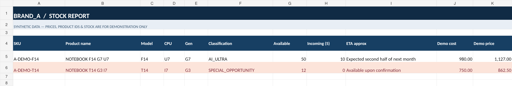

# Automatización de reportes de stock desde ERP

**Proyecto de portfolio que demuestra una solución de automatización de inventario para un distribuidor B2B de tecnología.**



**Tecnologías:** Microsoft Power Automate · Office Scripts (TypeScript) · Excel Online · OneDrive / SharePoint · JavaScript para la demostración reproducible.

> **Confidencialidad:** este repositorio utiliza datos **100 % ficticios** y una implementación demostrativa independiente. No contiene scripts internos, archivos del ERP real, costos empresariales, enlaces privados ni credenciales. El ejemplo local funciona; los scripts de Office requieren configurar Microsoft 365. El proyecto de cotizaciones con IA es una idea futura y no se presenta como desarrollado.

## El problema

Un equipo comercial necesita consultar stock consolidado por artículo y depósito, distinguir unidades disponibles de unidades entrantes, identificar modelos, aplicar criterios comerciales y acceder a comentarios de compras, sin reconstruir planillas manualmente todos los días.

## La solución

1. El usuario sube el exportable del ERP a una carpeta de OneDrive.
2. Power Automate detecta el archivo y ejecuta scripts de Excel.
3. El proceso consolida las cantidades de los depósitos relevantes.
4. Identifica modelo, generación y procesador a partir de la descripción.
5. Aplica reglas comerciales, recupera comentarios ETA y destaca casos pendientes.
6. Produce un Excel separado por categorías y disponible para el equipo comercial.

## Vista de la arquitectura


## Ejecutar la demostración

Se necesita **Node.js 20 o posterior**, sin paquetes externos:

```bash
npm test
npm run demo
```

Los resultados ficticios se guardan en `demo/output/`. También podés abrir `assets/demo-report.xlsx` para ver una versión formateada.

**Resultado de prueba:** 9 registros del ERP, 5 artículos únicos, 4 artículos en el reporte y 1 artículo pendiente de clasificación.

## Mi aporte

- Relevamiento de necesidades de las áreas Comercial y Compras.
- Diseño del proceso y de las reglas de negocio.
- Implementación e iteración con Power Automate y Office Scripts.
- Validaciones de stock y clasificación, mejoras de usabilidad, formatos y accesos.

## Seguridad

El código y los datos son ilustrativos. **No publiques los archivos de producción sin autorización formal**. Antes de subir un repositorio a GitHub, consultá la lista de revisión en [docs/SECURITY.md](docs/SECURITY.md).

Para textos listos para CV y LinkedIn: [docs/CV_AND_LINKEDIN.md](docs/CV_AND_LINKEDIN.md).

## Publicarlo en GitHub

Seguí los [pasos para publicar el repositorio](docs/PUBLISH_TO_GITHUB.md). Recomiendo comenzar con un repositorio privado hasta contar con la autorización correspondiente.
