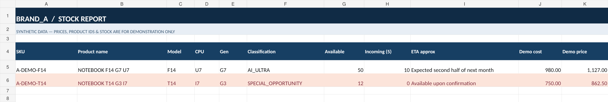
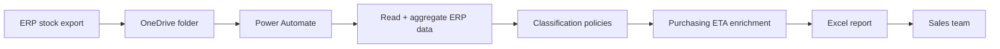

# ERP Inventory Reporting Automation

**A public, privacy-safe portfolio case study of a B2B technology inventory automation workflow.**



**Technology:** Microsoft Power Automate · Excel Office Scripts (TypeScript) · Excel Online · OneDrive / SharePoint · JavaScript (Node.js testing demo)

> **Disclosure:** This repository is an original, simplified **demonstration** using entirely fictional brands, SKUs, quantities, costs, and ETA comments. It does not contain an employer's source code, production files, credentials, internal URLs, or exported cloud flow. The local demo and tests are operational; the Microsoft 365 Office Scripts are illustrative adapters that require environment-specific setup. This work is *not* the proposed AI email-to-quotation system.

## The business problem

B2B sales teams rely on inventory information across multiple warehouses, purchasing updates, and product classification rules. A manual ERP-to-spreadsheet process can involve repetitive exports, lookups, inconsistent formatting, and uncertainty about stock availability versus expected incoming units.

**Goal:** design an automated reporting pipeline that converts a newly uploaded ERP spreadsheet into a consistent, sales-ready report while preserving commercial control over classifications and prices.

## What the workflow demonstrates

| Capability | Implementation illustrated |
|---|---|
| Triggered workflow | An ERP export uploaded to OneDrive starts Power Automate |
| Aggregation | Consolidate per-SKU inventory across selected warehouses |
| On-hand vs incoming | Keep current availability separate from incoming quantities |
| Data hygiene | Exclude products whose relevant stock indicators are both zero |
| Intelligent parsing | Extract model, generation and CPU from product descriptions |
| Business rules | Explicit, prioritized classification policies override generic fallback |
| Exceptions | Unknown commercial classifications are marked for review |
| Purchasing enrichment | Match ETA comments using a normalized product identifier |
| Report delivery | Generate categorized Excel views in a shared cloud folder |

## Architecture



More detail: [Architecture and design decisions](docs/ARCHITECTURE.md).

## Run the public demo (no Microsoft account needed)

Requirements: **Node.js 20 or later**. No npm dependencies and no secrets required.

```bash
npm test
npm run demo
```

The demo loads fictional records from `demo/input/` and writes four CSV reports plus a JSON summary to `demo/output/`.

Expected output:

```text
ERP rows read              9
Unique SKUs                5
SKUs in final report       4
Classification reviews    1
Available units           77
Incoming units            10
```

For an Excel-formatted preview, open [assets/demo-report.xlsx](assets/demo-report.xlsx). **All sample figures are made up.**

## How to inspect the sample

1. `A-DEMO-F14` illustrates dynamic extraction of **F14 / U7 / G7** without an explicit model dictionary entry.
2. `A-DEMO-T14` shows a commercial classification policy taking precedence over generic inference.
3. `B-DEMO-E14` is excluded because both stock indicators are zero.
4. A warehouse with ID `3` is ignored because it is out of scope.
5. A product without an applicable commercial rule is marked `REVIEW_REQUIRED` instead of receiving a guessed classification.

See [five-minute walkthrough](docs/DEMO_WALKTHROUGH.md).

## Repository structure

```text
inventory-automation-portfolio/
├── README.md / README.es.md
├── assets/
│   ├── demo-preview.png        # Synthetic report preview
│   └── demo-report.xlsx        # Synthetic formatted report
├── docs/
│   ├── ARCHITECTURE.md
│   ├── DEMO_WALKTHROUGH.md
│   ├── CV_AND_LINKEDIN.md
│   └── SECURITY.md
├── office-scripts/            # Illustrative Excel Online adapters
│   ├── 01_read_erp_sample.ts
│   ├── 02_read_rules_sample.ts
│   ├── 03_read_eta_sample.ts
│   └── 04_build_report_sample.ts
├── demo/input/                # Entirely fictional source data
├── demo/output/               # Reproducible sample output
├── src/                       # Runnable Node.js demo engine
├── tests/                     # Automated tests
└── .github/workflows/         # CI: test and generate sample output
```

## My role in the original project

- Gathered operational requirements and translated them into structured rules and outputs.
- Designed an automated ERP-to-Excel reporting workflow using Microsoft 365 tools.
- Iterated on user-facing usability, classification exceptions, warehouse logic, report format, and delegated access.
- Coordinated business and technical validation throughout development.

No time-saving or financial KPI is claimed here because no approved measurement is included.

## Security and scope

This is **not production configuration** and must not be pasted into a live environment unchanged. Corporate connectors, workbook layouts, permissions, licensing, secrets handling and failure recovery must be configured independently. Read the [public publishing checklist](docs/SECURITY.md).

The separate AI-assisted quotation assistant and managerial dashboard discussed as future possibilities are **not included** and are not presented as delivered work.

## CV / LinkedIn copy

See [English and Spanish portfolio descriptions](docs/CV_AND_LINKEDIN.md).

## Publishing

For a beginner-friendly publishing guide, see [Publish to GitHub (Spanish)](docs/PUBLISH_TO_GITHUB.md). Start with a private repository until disclosure is approved.
