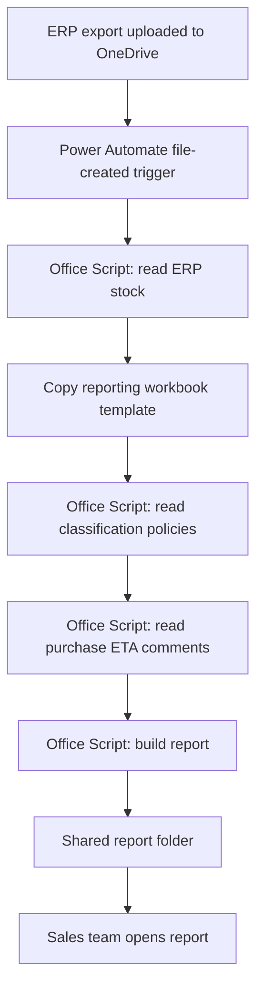

# Architecture

The diagram below describes the *pattern* demonstrated by this portfolio project. Names and connectors are illustrative.

## Responsibilities

| Layer | Responsibility |
|---|---|
| ERP export | Source of SKU and warehouse-level available quantities |
| OneDrive / SharePoint | Controlled input/output storage |
| Power Automate | Orchestration, trigger, template copy, execution history |
| Excel Office Scripts | Workbook I/O and report formatting |
| Classification policies | Explicit, prioritized commercial rules |
| ETA feed | Supplier / purchasing text matched by normalized item ID |
| Reporting workbook | Inventory grouped by brand and available to authorized users |

## Aggregation and data quality

- Only warehouses **5, 7, 8, 12 and 15** are relevant to this synthetic example.
- The availability indicator adds warehouses **7 + 8 + 12 + 15**.
- Warehouse **5** is kept separate as incoming stock.
- Products with zero in **both** quantities are excluded.
- Explicit commercial classification rules have priority. New models can be recognized from text; unresolved classification is flagged for review.
- Purchasing ETA is joined on normalized SKU, using invented demonstration prefixes `A-` and `B-`.

## Source of truth and correctness

This portfolio illustrates a cloud orchestration pattern; **it is not a deployable copy of the organization's production flow**. Any real deployment must account for corporate licensing, data governance, rate limits, connectors, credentials, workbook lock conflicts, permissions, telemetry, and error handling.

## Next steps (not part of this implementation)

AI-assisted email classification, quotation recommendations and a sales dashboard are *future project concepts* and must not be presented as completed functionality.
